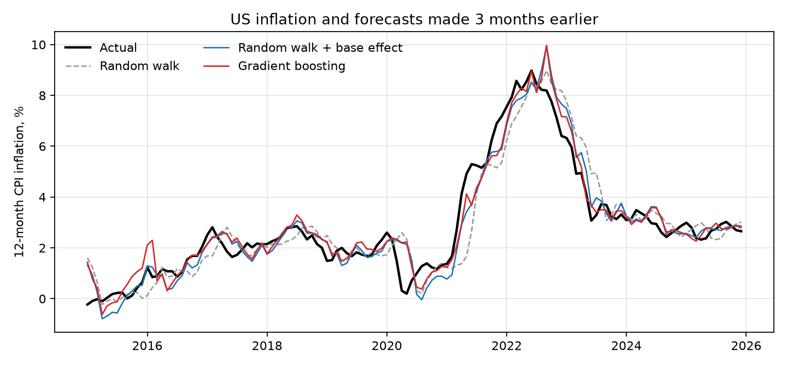

# Can machine learning forecast US inflation better than traditional models?

**Short answer: not beyond the base effect.** Against a random walk, machine learning looks very good: 15–40% more accurate at 1–3 months ahead. Almost all of that gain is the **base effect**: part of the next months' change in 12-month inflation is known today, because old monthly rates drop out of the 12-month window. A "random walk + base effect" forecast, which is plain arithmetic with no estimation, is just as accurate. On the full FRED-MD panel (126 series, 2000 to September 2026), **no machine learning model beats it significantly at any horizon in any period**, except gradient boosting at 3 months after 2020. The linear 12-lag AR is equally accurate there.

This is the US version of my earlier test on Kazakhstan ([-kazakhstan-inflation-ml](https://github.com/romagoat10/-kazakhstan-inflation-ml)). All code is in Python. The research design was written down before the main run: see [DESIGN.md](DESIGN.md).



## Main results (confirmatory run: full FRED-MD)

Same code and settings as the exploratory runs below, on the FRED-MD vintage of October 2026 (`data/2026-10-MD.csv`: 126 series, 1959–2026-09). Training from 1962, forecasts from January 2000. FRED-MD has no food CPI or natural gas price, so GB+X here uses oil, the federal funds rate, M2 and exchange rates. Run it with `set US_DATA=fredmd`. Results are in `results/fredmd_change/`.

**1. The base effect alone is worth 20–35% at 1–3 months.** RMSE of RW-B relative to the random walk:

| Horizon | 2000–07 | 2008–19 | 2020–26 |
|---|---|---|---|
| 1 month | 0.65 (p < 0.001) | 0.73 (p = 0.01) | 0.66 (p = 0.002) |
| 3 months | 0.75 (p = 0.02) | 0.80 (p = 0.06) | 0.70 (p = 0.02) |
| 6 months | 0.87 (p = 0.07) | 0.88 (p = 0.10) | 0.80 (p = 0.05) |
| 12 months | 1.00 (no base effect left) | 1.00 | 1.00 |

**2. Beyond the base effect, machine learning adds almost nothing.** RMSE relative to RW-B (below 1 = better). Bold = significant after the Holm correction:

| Horizon | Period | AR12 (linear) | GB | GB+X | GB+F | RF+F |
|---|---|---|---|---|---|---|
| 1 month | 2000–07 | 0.94 | 1.00 | 0.96 | 1.04 | 1.05 |
| 1 month | 2008–19 | 0.90 | 1.04 | 0.97 | 1.00 | 1.08 |
| 1 month | 2020–26 | 0.87 | 0.87 | 0.94 | 0.91 | 1.00 |
| 3 months | 2000–07 | 0.94 | 0.95 | 1.00 | 1.02 | 1.06 |
| 3 months | 2008–19 | 1.01 | 1.06 | 1.03 | 1.14 | 1.11 |
| 3 months | 2020–26 | 0.86 | **0.86** | 1.11 | 1.10 | 1.06 |
| 6 months | 2000–07 | 1.03 | 0.99 | 0.98 | 1.04 | 1.01 |
| 6 months | 2008–19 | 1.08 | 1.06 | 0.99 | 1.18 | 1.15 |
| 6 months | 2020–26 | 0.85 | 0.87 | 1.11 | 1.01 | 1.05 |
| 12 months | 2000–07 | 1.18 | 1.01 | 0.92 | 1.13 | 0.98 |
| 12 months | 2008–19 | 1.14 | 1.03 | 0.97 | 0.98 | 0.96 |
| 12 months | 2020–26 | 0.82 | 0.83 | 0.89 | 0.86 | 0.92 |

**3. The one exploratory machine-learning win did not replicate.** On the 21-series panel, GB+F was 27% better than the linear AR12 at 12 months in 2000–07 (p < 0.001). On FRED-MD the same comparison gives 0.96 (p = 0.61). With more data, that result disappears.

**4. After 2020, models that learn from recent inflation beat the base-effect benchmark by 13–15%, and the linear AR12 does it as well as gradient boosting** (`results/fredmd_change/figure_rolling.png`). The 2021–23 episode rewards using recent dynamics, but it does not reward machine learning in particular.

**5. Adding information from 126 series did not help.** The factor-augmented AR (FAAR) and GB+F were no better, and FAAR was often worse than the plain AR. My factor step is simple: principal components, with missing values set to the mean, and no outlier treatment. Better factor methods are the obvious next test; I did not change anything after seeing these results.

**Conclusion so far:** for US inflation, the headline "machine learning beats the random walk" is mostly the base effect. Any honest comparison should include a benchmark that knows it.

## Exploratory runs (21-series DBnomics panel)

These came first and shaped DESIGN.md.

### Data

`fetch_data.py` downloads 21 monthly US series from [DBnomics](https://db.nomics.world), which mirrors the original sources:

| Group | Series | Source |
|---|---|---|
| Prices | CPI (the target), CPI food, energy, core, shelter, services, commodities; PPI all commodities; PPI crude oil; PPI natural gas | BLS |
| Labour market | unemployment rate, nonfarm payrolls, average hourly earnings | BLS |
| Interest rates | federal funds rate, 10-year Treasury, 3-month Treasury bill | Federal Reserve (H.15) |
| Money and output | M2 money stock, industrial production | Federal Reserve (H.6, G.17) |
| Exchange rates | dollar against the pound, yen and Canadian dollar | Federal Reserve (H.10) |

The BLS series on DBnomics end in **January 2025**, so that is the last month used. Each series is made stationary with the FRED-MD transformation codes (McCracken and Ng, 2016).

**Why this panel first?** The St. Louis Fed's site could not be reached from my scripts, so I started with this panel. FRED-MD was later downloaded by hand and is used for the main results above.

### Method

- **Target:** 12-month CPI inflation h months ahead, for h = 1, 3, 6 and 12.
- **Testing:** pseudo out-of-sample, expanding window, training from 1973, forecasts from January 2000. At each forecast date, factors, scaling and models use only data up to that date. Models are refit every 3 months.
- **Accuracy:** RMSE relative to the random walk, for 2000–2007, 2008–2019 and 2020–Jan 2025. Diebold–Mariano tests with Newey–West variance.

| Model | Type | Inputs |
|---|---|---|
| RW | traditional | today's 12-month inflation (Atkeson and Ohanian, 2001) |
| AR | traditional | 12-month inflation and the last 3 monthly rates |
| FAAR | traditional | AR plus 5 factors (principal components) from the whole panel (Stock and Watson, 2002) |
| AR12 | traditional | 12-month inflation and the last 12 monthly rates (fairness check, `ar12_check.py`) |
| GB | machine learning | gradient boosted trees on 12-month inflation and the last 12 monthly rates |
| GB+X | machine learning | GB plus oil, natural gas, food prices, federal funds rate, M2 and exchange rates |
| GB+F | machine learning | GB plus the 5 factors |
| RF+F | machine learning | random forest on the same inputs as GB+F |
| AVG | combination | (AR + GB+F) / 2 |

The tree models predict the **change** from today's 12-month inflation, and that change is added back to today's rate. (Details in "What went wrong first" below.)

### Results

RMSE relative to the random walk (below 1 = better). Bold = best model in the row. Full numbers and p-values are in `results/change/rmse_table.csv`.

| Horizon | Period | AR | FAAR | AR12 | GB | GB+X | GB+F | RF+F | AVG |
|---|---|---|---|---|---|---|---|---|---|
| 1 month | 2000–07 | 1.05 | 1.04 | **0.61** | 0.66 | 0.68 | 0.66 | 0.73 | 0.83 |
| 1 month | 2008–19 | 0.92 | 0.91 | **0.65** | 0.75 | 0.76 | 0.76 | 0.77 | 0.79 |
| 1 month | 2020–25 | 0.91 | 0.93 | 0.57 | 0.58 | 0.59 | **0.54** | 0.58 | 0.68 |
| 3 months | 2000–07 | 1.08 | 1.04 | 0.72 | 0.76 | 0.74 | **0.72** | 0.75 | 0.87 |
| 3 months | 2008–19 | 0.93 | 0.89 | **0.81** | 0.84 | 0.85 | 0.84 | 0.85 | 0.84 |
| 3 months | 2020–25 | 0.90 | 1.06 | 0.61 | **0.60** | 0.71 | 0.64 | 0.67 | 0.74 |
| 6 months | 2000–07 | 1.18 | 1.13 | 0.91 | 0.92 | 0.86 | 0.87 | **0.84** | 0.97 |
| 6 months | 2008–19 | 0.89 | 0.87 | 0.95 | 0.92 | **0.86** | 0.91 | 0.90 | 0.87 |
| 6 months | 2020–25 | 0.84 | 0.91 | **0.68** | 0.70 | 0.94 | 0.75 | 0.78 | 0.78 |
| 12 months | 2000–07 | 1.22 | 1.12 | 1.21 | 1.07 | **0.74** | 0.88 | 0.88 | 1.00 |
| 12 months | 2008–19 | 1.00 | 1.00 | 1.15 | 0.98 | **0.91** | 0.93 | 0.94 | 0.94 |
| 12 months | 2020–25 | 0.85 | 0.88 | 0.82 | **0.81** | 0.86 | 0.85 | 0.88 | 0.84 |

Machine learning against the fair linear benchmark, AR12 (`results/change/ar12_check.csv`; below 1 = machine learning better; p-value in brackets):

| Horizon | 2000–07 GB+F | 2008–19 GB+F | 2020–25 GB+F |
|---|---|---|---|
| 1 month | 1.08 (0.17) | 1.17 (0.12) | 0.94 (0.45) |
| 3 months | 1.00 (0.99) | 1.03 (0.64) | 1.05 (0.39) |
| 6 months | 0.95 (0.63) | 0.95 (0.47) | 1.10 (0.11) |
| 12 months | **0.73 (0.000)** | 0.81 (0.11) | 1.03 (0.67) |

### What I found

1. **Against a random walk, every model that uses the last 12 monthly rates wins big at 1–3 months.** These gains are 20–45%, and significant at 1 month (p < 0.01).
2. **That gain mostly comes from a simple fact, not from machine learning.** Next month's 12-month inflation equals today's, plus next month's monthly rate, minus the monthly rate from 11 months ago, which drops out of the window. Any model that sees that old rate knows part of the change in advance. The linear AR12 uses this as well as the trees do. At 1–6 months, machine learning is never significantly better than AR12.
3. **Machine learning helps at 12 months ahead, before 2020.** GB+F is 27% more accurate than AR12 in 2000–07 (p < 0.001) and 19% in 2008–19 (p = 0.11). At that horizon the base effect no longer helps, and the factors from the whole panel carry real information.
4. **The named drivers help only at long horizons.** GB+X (oil, gas, food, interest rates, M2, exchange rates) is the best model at 12 months in 2000–07 (0.74). At 1–3 months it is no better than GB, and at 6 months after 2020 it is clearly worse (0.94 vs 0.70).
5. **After 2020 nothing beats the simple benchmark at 12 months.** All models are 12–19% better than the random walk there, but none is better than AR12. The 2021–22 surge was hard for every model.
6. **Same conclusion as Kazakhstan, with more power.** In both countries, the gain from machine learning over a properly specified linear model is small. With 25 years of US data, the tests can now say *where* it is real (long horizons) and where it is not (short horizons).

### How much of the gain is the base effect? (`base_effect.py`, exploratory)

The research question for the full paper is set out in [DESIGN.md](DESIGN.md). The new benchmark is **RW-B**: a random walk that also knows the base effect. It removes the monthly rates that will drop out of the 12-month window and assumes the coming months will match the average of the last 12. There is no estimation and no machine learning. At 12 months ahead there is no base effect left, so RW-B equals RW.

**RW-B alone is 20–35% better than the random walk at 1–3 months** (p ≤ 0.02 in most periods).

RMSE relative to RW-B (below 1 = better than the base-effect random walk; Holm-corrected p-values in `results/change/base_effect.csv`):

| Horizon | Period | AR12 | GB | GB+X | GB+F | RF+F |
|---|---|---|---|---|---|---|
| 1 month | 2000–07 | 0.94 | 1.01 | 1.04 | 1.02 | 1.11 |
| 1 month | 2008–19 | 0.90 | 1.03 | 1.04 | 1.05 | 1.06 |
| 1 month | 2020–25 | 0.86 | 0.87 | 0.88 | 0.81 | 0.87 |
| 3 months | 2000–07 | 0.96 | 1.02 | 0.99 | 0.96 | 1.00 |
| 3 months | 2008–19 | 1.02 | 1.05 | 1.07 | 1.05 | 1.06 |
| 3 months | 2020–25 | 0.86 | **0.86** | 1.01 | 0.90 | 0.95 |
| 6 months | 2000–07 | 1.05 | 1.06 | 0.99 | 0.99 | 0.97 |
| 6 months | 2008–19 | 1.09 | 1.06 | 0.98 | 1.04 | 1.03 |
| 6 months | 2020–25 | 0.85 | **0.88** | 1.17 | 0.94 | 0.98 |
| 12 months | 2000–07 | 1.21 | 1.07 | **0.74** | 0.88 | 0.88 |
| 12 months | 2008–19 | 1.15 | 0.98 | 0.91 | 0.93 | 0.94 |
| 12 months | 2020–25 | 0.82 | 0.81 | 0.86 | 0.85 | 0.88 |

Bold = significantly better than RW-B after the Holm correction (p < 0.01).

- **Before 2020, at 1–6 months, no model beats RW-B.** The whole apparent advantage of machine learning there is the base effect.
- **After 2020, gradient boosting beats RW-B by 12–14% at 3 and 6 months, but so does the linear AR12** (0.86 and 0.85). The post-2020 gain comes from learning recent inflation dynamics, which a linear model does as well. It is not specific to machine learning. (GB passes the Holm-corrected test and AR12 does not, but their accuracy is the same; see `figure_rolling.png`.)
- **At 12 months, where there is no base effect,** GB+X (oil, gas, food, interest rates, money, exchange rates) is 26% better in 2000–07.

These are exploratory results from the 21-series panel. The confirmatory test is the same code on the full FRED-MD panel (see DESIGN.md).

### What went wrong first (kept on purpose)

In the first run (`python forecast.py levels`, saved in `results/levels/`), the trees predicted the **level** of 12-month inflation. At 1 month ahead they were 2–3 times **worse** than the random walk (e.g. GB 2.31 in 2008–19). Two reasons:

- Trees cannot add up 12 monthly numbers.
- Trees cannot predict values outside the training range, such as the 2009 deflation.

Predicting the change from today fixes both, and is standard in the forecasting literature. I report both runs so the switch is visible. The AR12 check was added after the second run, because the large gains looked too good and needed a fair linear comparison.

## Limitations

- Final revised data, not the data available in real time (CPI is barely revised, but payrolls and industrial production are), and no allowance for publication lags.
- A simple factor step (principal components with mean-filled gaps, no outlier treatment), and tree settings chosen once and never tuned. Both may understate what machine learning can do. That is a fair criticism, but tuning after seeing the results would be worse.
- One country so far in this setup (the Kazakhstan study predates the base-effect benchmark).
- The Holm correction is applied across models within each horizon and period, not across all 12 horizon-period cells.

## Next steps

1. Real-time FRED-MD vintages (the St. Louis Fed publishes every monthly vintage since 1999).
2. Better factor methods (FRED-MD's own outlier and missing-value treatment, targeted predictors) and tuned models, tested on a hold-out period.
3. Add survey inflation expectations (Michigan, SPF) and neural networks.
4. Apply the base-effect benchmark to Kazakhstan and the UK to see if the finding holds in other economies.

## Run it

```
python -m pip install pandas numpy scikit-learn matplotlib
python fetch_data.py
python forecast.py
python forecast.py levels
python ar12_check.py
python base_effect.py
python figures.py
```

For the main results on FRED-MD (Windows PowerShell), set the dataset first, then run the same scripts:

```
$env:US_DATA = "fredmd"
python forecast.py
python ar12_check.py
python base_effect.py
python figures.py
```

`forecast.py` takes about 20–40 minutes. The data in `data/` let the results be reproduced without downloading.
